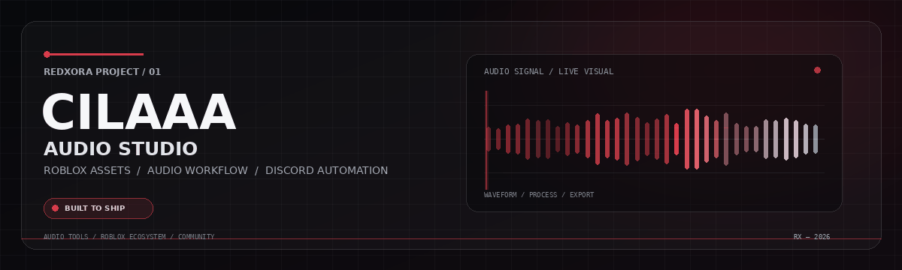

<p align="center">
  
</p>

<p align="center">
  <a href="https://github.com/redxora/Website-Audio-Roblox"></a>
  
  
  
  
  
</p>

<p align="center">
  <b>Satu ruang kerja untuk audio, aset Roblox, dan otomasi komunitas Discord.</b><br />
  <sub>Dibangun untuk workflow yang lebih teratur — mulai dari pengolahan audio, pengelolaan aset, hingga integrasi akun dan langganan.</sub>
</p>

<p align="center">
  <a href="#-fitur-utama">Fitur</a> ·
  <a href="#-mulai-dalam-5-menit">Mulai Cepat</a> ·
  <a href="#-konfigurasi-env">Konfigurasi</a> ·
  <a href="#-deploy-ke-vps-dengan-docker">Deploy VPS</a> ·
  <a href="#-perintah-bot-discord">Perintah Bot</a>
</p>

---

## ◈ Tentang proyek

**Website Audio Roblox** adalah aplikasi berbasis **Next.js** untuk workflow audio dan aset Roblox yang terhubung dengan bot Discord. Repository ini juga berisi konfigurasi Docker, database SQLite, penyimpanan audio lokal, autentikasi Discord, konfigurasi paket langganan, serta jalur integrasi Roblox dan pembayaran.

> **Catatan:** nama produk yang muncul di beberapa bagian kode adalah **Cilaaa Community**. Integrasi eksternal tetap membutuhkan kredensial dan pengaturan dari pemilik masing-masing layanan.

## ✦ Fitur utama

| Modul | Yang tersedia di proyek |
|---|---|
| **Audio Studio** | Antarmuka audio berbasis React dan komponen `@audio-ui`, alur pengolahan audio, serta pengaturan batas durasi, ukuran unggahan, dan sample rate melalui environment. |
| **Roblox Asset Tools** | Perintah bot untuk mengambil aset berdasarkan ID/tautan, unduhan batch sesuai batas paket, dan alur pengajuan unggah audio Roblox. |
| **Discord Bot** | Slash commands untuk unduhan, konversi/alur audio, paket, status langganan, antrean, riwayat, statistik, dan bantuan. |
| **Akun & Langganan** | Login Discord OAuth2, pemetaan role Discord, kode paket, batas penggunaan, dan pemeriksaan masa aktif langganan. |
| **Penyimpanan Lokal** | SQLite untuk data aplikasi dan direktori lokal untuk berkas audio. Jalur keduanya dapat diatur melalui `.env`. |
| **Integrasi Pembayaran** | Variabel konfigurasi untuk API/callback Tako dan webhook audit pembelian Discord. Aktifkan hanya setelah kredensial serta callback provider disiapkan. |
| **Deployment** | `Dockerfile`, `docker-compose.yml`, konfigurasi PM2, dan endpoint pemeriksaan kesehatan `/api/health`. |

Fitur yang memakai Discord, Roblox, atau provider pembayaran tidak otomatis aktif hanya dengan menginstal dependensi. Siapkan konfigurasi yang diperlukan, lalu uji alurnya pada lingkungan staging sebelum dipakai pengguna.

## ◈ Teknologi

- **Web:** Next.js 16, React 19, JavaScript, Tailwind utility ecosystem.
- **Interaksi audio & animasi:** `@audio-ui`, GSAP, Motion, Lenis, dan `lamejs`.
- **Bot:** Node.js dan discord.js v14.
- **Data:** SQLite melalui `better-sqlite3`.
- **Operasional:** Docker Compose, PM2, FFmpeg, dan `yt-dlp` untuk lingkungan yang memerlukannya.

## ⌁ Arsitektur ringkas

```mermaid
flowchart TD
    U[Pengguna / Browser] --> W[Next.js Web Studio]
    D[Pengguna Discord] --> B[Bot Discord.js]
    W --> DB[(SQLite)]
    W --> FS[(Penyimpanan Audio)]
    B --> DB
    B --> R[Roblox API / Open Cloud]
    W <--> O[Discord OAuth2]
    W <--> P[Tako Payment Callback]
    W --> H[/api/health]
```

**Penting:** jika web dan bot dijalankan sebagai dua container Docker, keduanya harus memakai penyimpanan data persisten yang sama untuk SQLite (dan direktori audio bila diperlukan). Lihat bagian [penyimpanan Docker](#-penyimpanan-persisten-docker-wajib-dicek).

---

## ⚡ Mulai dalam 5 menit

### 1. Persyaratan

- Node.js **20.9 atau lebih baru**; Node.js 22 direkomendasikan untuk mengikuti image Docker proyek.
- npm dan Git.
- Untuk instalasi langsung di VPS: FFmpeg, Python 3, dan `yt-dlp` jika workflow yang dipakai membutuhkannya.
- Akun/aplikasi Discord Developer untuk login OAuth2 atau bot, apabila integrasi Discord ingin diaktifkan.

### 2. Ambil kode dan instal dependensi

```bash
git clone https://github.com/redxora/Website-Audio-Roblox.git
cd Website-Audio-Roblox
npm ci
```

### 3. Buat file environment

Linux/macOS:

```bash
cp .env.example .env
```

Windows PowerShell:

```powershell
Copy-Item .env.example .env
```

Buka `.env`, lalu isi variabel yang diperlukan. Buat kunci enkripsi acak untuk menyimpan kredensial Roblox:

```bash
node -e "console.log(require('crypto').randomBytes(32).toString('hex'))"
```

Salin hasilnya ke `APP_ENCRYPTION_KEY`. Nilainya harus berupa **64 karakter heksadesimal**. Simpan kunci dengan aman dan jangan menggantinya setelah data rahasia terenkripsi tersimpan, kecuali kamu siap menyimpan ulang kredensial tersebut.

### 4. Jalankan situs dalam mode pengembangan

```bash
npm run dev
```

Buka `http://localhost:3000`.

### 5. Jalankan bot Discord (terminal terpisah)

Isi minimal `DISCORD_BOT_TOKEN`, `DISCORD_CLIENT_ID`, dan `DISCORD_GUILD_ID` di `.env`. Daftarkan slash commands ke server Discord:

```bash
npm run bot:register
```

Kemudian jalankan bot:

```bash
npm run bot
```

> `npm run bot:register` perlu dijalankan lagi setelah definisi slash command berubah. Untuk pengembangan, web dan bot berjalan sebagai dua proses terpisah.

---

## ⚙️ Konfigurasi `.env`

`.env.example` adalah sumber daftar variabel. Isi hanya integrasi yang benar-benar digunakan; beberapa variabel boleh kosong jika fitur terkait tidak dipakai. Jangan unggah `.env` ke GitHub.

### Situs, database, dan audio

| Variabel | Fungsi |
|---|---|
| `NEXT_PUBLIC_SITE_URL` | URL situs, contoh lokal `http://localhost:3000`; ganti ke HTTPS domain produksi. |
| `NEXT_PUBLIC_DISCORD_INVITE_URL` | Tautan undangan server Discord. |
| `SQLITE_DB_PATH` | Lokasi file SQLite. Jika kosong, contoh konfigurasi memakai lokasi bawaan di direktori proyek. |
| `AUDIO_STORAGE_DIR` | Direktori berkas audio. Jika kosong, contoh konfigurasi memakai direktori `data/audio-files`. |
| `APP_ENCRYPTION_KEY` | Kunci AES-256-GCM untuk data rahasia yang disimpan terenkripsi; buat dengan perintah di atas. |
| `FREE_CONVERSIONS_PER_24H` | Batas konversi gratis per 24 jam; contoh nilai awal `2`. |
| `NEXT_PUBLIC_MAX_AUDIO_DURATION_SECONDS` | Batas durasi audio; contoh nilai `420` detik. |
| `NEXT_PUBLIC_MAX_UPLOAD_SIZE_MB` | Batas ukuran unggahan; contoh nilai `50` MB. |
| `NEXT_PUBLIC_AUDIO_SAMPLE_RATE` | Sample rate audio yang digunakan sebagai konfigurasi; contoh nilai `22050`. |

### Discord OAuth2 dan bot

| Variabel | Fungsi |
|---|---|
| `DISCORD_CLIENT_ID` | Application ID Discord; dipakai untuk OAuth2 dan pendaftaran command. |
| `DISCORD_CLIENT_SECRET` | Client secret OAuth2. Rahasiakan. |
| `DISCORD_REDIRECT_URI` | Redirect URI OAuth2 bila diminta oleh konfigurasi aplikasi. Samakan persis dengan Discord Developer Portal. |
| `DISCORD_BOT_TOKEN` | Token bot Discord. Rahasiakan dan reset jika bocor. |
| `DISCORD_GUILD_ID` | ID server Discord tempat slash commands didaftarkan. |
| `DISCORD_ROLE_OWNER` | ID role pemilik. |
| `DISCORD_ROLE_ADMIN` | ID role administrator. |
| `DISCORD_ROLE_STAFF` | ID role staf. |
| `DISCORD_ROLE_LIFETIME` | ID role paket permanen. |
| `DISCORD_ROLE_MONTHLY` | ID role paket bulanan. |
| `DISCORD_ROLE_WEEKLY` | ID role paket mingguan. |
| `DISCORD_ROLE_BOOSTER` | ID role booster bila digunakan. |
| `DISCORD_ROLE_30DAYS` | ID role untuk masa aktif 30 hari bila digunakan. |
| `DISCORD_ROLE_7DAYS` | ID role untuk masa aktif 7 hari bila digunakan. |
| `DISCORD_ROLE_6MONTHS` | ID role untuk masa aktif 6 bulan bila digunakan. |
| `DISCORD_ROLE_MEMBER` | ID role anggota biasa bila digunakan. |
| `DISCORD_ROLE_PLAN_MAP` | Pemetaan role/paket khusus dalam format JSON; gunakan sintaks JSON valid. |

### Roblox, pembayaran, dan webhook

| Variabel | Fungsi |
|---|---|
| `ROBLOX_COOKIE` | Cookie Roblox untuk jalur yang masih membutuhkannya. Sangat sensitif; jangan bagikan atau commit ke repository. Utamakan API resmi jika tersedia. |
| `TAKO_API_KEY` | API key provider Tako. |
| `TAKO_CREATOR_USERNAME` | Username kreator/provider yang terkait dengan konfigurasi Tako. |
| `TAKO_CALLBACK_SECRET` | Secret untuk verifikasi callback pembayaran. |
| `TAKO_USER_AGENT` | User-Agent untuk request terkait integrasi pembayaran; contoh `cilaaa-audio-app/1.0`. |
| `DISCORD_PURCHASE_WEBHOOK_URL` | URL webhook Discord untuk audit pembelian. Rahasiakan URL lengkapnya. |
| `TASK_SECRET` | Secret untuk endpoint tugas pemeliharaan administratif. Buat nilai acak dan kuat. |
| `INTERNAL_WEBHOOK_SECRET` | Secret untuk endpoint sinkronisasi subscription internal. |

> **Aturan keamanan:** awalan `NEXT_PUBLIC_` menandakan nilai yang dapat digunakan di sisi browser. Jangan pernah menaruh token, secret, cookie, API key privat, atau data autentikasi pada variabel berawalan `NEXT_PUBLIC_`.

---

## ◈ Menyiapkan Discord

1. Buka [Discord Developer Portal](https://discord.com/developers/applications), lalu buat application.
2. Salin **Application ID** ke `DISCORD_CLIENT_ID` dan buat bot untuk mendapatkan `DISCORD_BOT_TOKEN`.
3. Untuk login website, isi OAuth2 Client Secret dan tambahkan redirect URI yang sama persis dengan `DISCORD_REDIRECT_URI` di `.env`.
4. Undang bot ke server target dengan scope `bot` dan `applications.commands`. Pastikan izin server sesuai kebutuhan bot.
5. Ambil ID server dan ID role melalui Developer Mode Discord, lalu isi variabel terkait di `.env`.
6. Jalankan `npm run bot:register`, kemudian `npm run bot`.

### Pemeriksaan bot

```bash
npm run bot:register
npm run bot
```

Perintah `register` menggunakan command scope server (`guild`) berdasarkan `DISCORD_GUILD_ID`. Jika command tidak muncul, pastikan tiga variabel wajibnya benar dan bot sudah bergabung ke server yang sesuai.

---

## ◈ Menyiapkan Roblox

1. Siapkan akun Roblox yang akan dipakai untuk mengelola aset.
2. Jika alur aplikasi memakai Roblox Open Cloud, buat API key pada portal resmi Roblox dan berikan hanya izin minimum yang dibutuhkan oleh workflow tersebut.
3. Hubungkan akun Discord ke website sesuai alur login, lalu simpan kredensial Roblox dari dashboard apabila fitur itu tersedia di deployment-mu.
4. Uji dengan aset milik sendiri atau aset yang memang boleh kamu gunakan. Pastikan hak penggunaan audio/aset dan ketentuan Roblox dipatuhi.

`ROBLOX_COOKIE` hanya diperlukan untuk jalur tertentu yang menggunakannya. Jangan menempelkan cookie ke chat, issue GitHub, log, atau screenshot. Ketersediaan fitur unggah dapat bergantung pada izin Open Cloud, jenis aset, status moderasi Roblox, dan implementasi worker yang diaktifkan.

---

## ◈ Menyiapkan pembayaran Tako

1. Buat/ambil API key melalui [dokumentasi Tako](https://tako.id/api-docs) dan dashboard API key milik akunmu.
2. Isi `TAKO_API_KEY`, `TAKO_CREATOR_USERNAME`, serta `TAKO_CALLBACK_SECRET`.
3. Atur callback/webhook di dashboard provider sesuai endpoint yang memang disediakan oleh versi aplikasi yang kamu deploy.
4. Uji alur pembayaran menggunakan konfigurasi uji jika tersedia sebelum menerima pembayaran nyata.
5. Pastikan verifikasi callback, pencatatan transaksi, dan pemberian/perpanjangan role diuji dari awal sampai akhir.

**Jangan menebak URL callback.** Cocokkan endpoint dengan route yang ada di versi kode yang sedang kamu deploy dan konfigurasi pada dashboard provider.

---

## 🐳 Deploy ke VPS dengan Docker

Docker adalah cara deployment yang paling praktis karena `Dockerfile` proyek sudah menyiapkan runtime berbasis Node.js 22, FFmpeg, Python, dan `yt-dlp`.

### 1. Siapkan VPS

Pasang Docker Engine dan Docker Compose Plugin sesuai panduan resmi sistem operasi VPS. Clone repository, lalu buat `.env`:

```bash
git clone https://github.com/redxora/Website-Audio-Roblox.git
cd Website-Audio-Roblox
cp .env.example .env
nano .env
```

Isi minimal konfigurasi yang dibutuhkan dan ganti semua placeholder secret. Buat `APP_ENCRYPTION_KEY` dengan perintah generator pada bagian [mulai cepat](#3-buat-file-environment).

### 2. Bangun dan hidupkan layanan

```bash
docker compose up -d --build
```

Lihat log:

```bash
docker compose logs -f web
docker compose logs -f bot
```

Periksa health endpoint:

```bash
curl http://127.0.0.1:3000/api/health
```

Respons yang diharapkan memuat `"ok":true`. Port web di konfigurasi Compose terikat ke `127.0.0.1:3000`, sehingga cocok dipasang di belakang Nginx atau reverse proxy HTTPS. Jangan membuka port internal ini ke internet tanpa alasan.

### ◈ Penyimpanan persisten Docker (wajib dicek)

Konfigurasi Compose yang ada memisahkan layanan `web` dan `bot`. Karena SQLite dan audio berbasis berkas, **jangan biarkan kedua container memakai salinan data yang berbeda**. Tambahkan volume bernama yang sama ke kedua service di `docker-compose.yml`:

```yaml
services:
  web:
    # Pertahankan konfigurasi web yang sudah ada.
    volumes:
      - cilaaa-data:/app/data

  bot:
    # Pertahankan konfigurasi bot yang sudah ada.
    volumes:
      - cilaaa-data:/app/data

volumes:
  cilaaa-data:
```

Gabungkan bagian `volumes` ke blok `web` dan `bot` yang sudah ada; jangan membuat duplikat key `services` jika mengedit file yang sama. Mount `/app/data` cocok dengan lokasi default data pada konfigurasi contoh. Jika `SQLITE_DB_PATH` atau `AUDIO_STORAGE_DIR` diubah, pastikan direktori tujuan juga berada di volume persisten yang dapat diakses **oleh kedua layanan**.

Sesudah mengubah konfigurasi:

```bash
docker compose up -d --build
docker compose ps
```

Volume bernama tetap ada saat container dibuat ulang. Hindari `docker compose down -v` kecuali memang ingin menghapus volume dan datanya.

### Perintah Docker yang sering dipakai

```bash
# Status container
docker compose ps

# Log langsung
docker compose logs -f

# Restart layanan
docker compose restart

# Terapkan ulang setelah kode berubah
docker compose up -d --build

# Hentikan container (volume bernama tidak dihapus)
docker compose down
```

---

## 🖥️ Deploy langsung ke VPS tanpa Docker

Metode ini cocok jika kamu ingin mengelola proses memakai PM2. Gunakan Node.js 22, dan siapkan FFmpeg/Python/`yt-dlp` bila diperlukan workflow aplikasi.

```bash
npm ci
cp .env.example .env
nano .env
npm run build
```

Karena `next.config.mjs` mengaktifkan `output: "standalone"`, salin aset statis ke direktori standalone sebelum server dijalankan:

```bash
mkdir -p .next/standalone/.next
cp -r public .next/standalone/public
cp -r .next/static .next/standalone/.next/
```

Jika belum terpasang, pasang PM2:

```bash
npm install --global pm2
```

Jalankan dua proses yang sudah didefinisikan di `ecosystem.config.cjs`:

```bash
pm2 start ecosystem.config.cjs
pm2 save
pm2 status
```

Perintah untuk memantau log dan memulai ulang:

```bash
pm2 logs
pm2 restart ecosystem.config.cjs --update-env
```

Atur Nginx/reverse proxy agar domain HTTPS meneruskan permintaan ke `http://127.0.0.1:3000`. Atur juga backup rutin untuk database SQLite dan folder audio. Pastikan web dan bot berjalan dari folder proyek yang sama agar file `.env` serta jalur data konsisten.

> `output: "standalone"` menggunakan server hasil build di `.next/standalone/server.js`. Karena itu, untuk production standalone gunakan entry point tersebut melalui konfigurasi PM2 atau jalankan `node .next/standalone/server.js`; jangan mengandalkan `next start` tanpa memeriksa mode output proyek.

---

## 🤖 Perintah bot Discord

Daftar berikut berasal dari definisi slash commands pada repository. Opsi yang tersedia ditampilkan langsung oleh Discord setelah command didaftarkan.

| Perintah | Kegunaan |
|---|---|
| `/download` | Mengambil satu aset Roblox berdasarkan ID atau tautan. |
| `/spoofer` | Jalur unduh aset Roblox yang menggunakan handler download. |
| `/batchdownload` | Mengunduh beberapa aset Roblox sekaligus sesuai batas paket. |
| `/convert` | Memulai alur pengolahan file audio dari lampiran Discord. |
| `/upload-roblox` | Memulai alur pengajuan unggah audio ke akun/grup Roblox. |
| `/plans` | Melihat informasi paket dan harga yang didefinisikan aplikasi. |
| `/status` | Memeriksa status langganan, masa aktif, kuota, dan role akun. |
| `/mystats` | Melihat statistik aktivitas akun. |
| `/history` | Melihat lima unduhan aset terakhir yang tercatat. |
| `/queue` | Memeriksa status antrean pemrosesan. |
| `/library` | Melihat katalog audio populer dan memfilter nama game bila tersedia. |
| `/help` | Membuka panduan perintah bot. |
| `/ping` | Memeriksa latensi bot. |
| `/uptime` | Memeriksa waktu aktif proses. |
| `/tos` | Melihat ketentuan layanan dan kebijakan penggunaan. |

Batas paket dan fitur tertentu ditentukan dari konfigurasi paket aplikasi, bukan hanya dari daftar command. Uji hasil nyata tiap alur sebelum mengaktifkannya di server publik.

---

## 🩺 Pemeriksaan & pemecahan masalah

### Website tidak bisa dibuka

- Pastikan build berhasil dan port yang dipakai benar.
- Di Docker, jalankan `docker compose ps` lalu periksa `docker compose logs -f web`.
- Periksa health endpoint: `curl http://127.0.0.1:3000/api/health`.
- Pastikan reverse proxy meneruskan traffic ke port lokal yang benar dan sertifikat HTTPS valid.

### Slash command tidak muncul

- Pastikan `DISCORD_BOT_TOKEN`, `DISCORD_CLIENT_ID`, dan `DISCORD_GUILD_ID` tidak kosong.
- Pastikan bot sudah diundang ke server tersebut.
- Jalankan ulang `npm run bot:register` dan periksa output terminal.

### Kredensial Roblox tidak bisa didekripsi

Pastikan `APP_ENCRYPTION_KEY` sama dengan kunci yang dipakai ketika kredensial disimpan. Jika kunci berubah, simpan ulang kredensial melalui dashboard. Jangan menaruh kunci di log atau issue publik.

### Audio tidak dapat diproses

- Pastikan ekstensi dan ukuran file sesuai batas konfigurasi paket.
- Untuk deployment tanpa Docker, periksa apakah FFmpeg dan `yt-dlp` (bila digunakan oleh jalur tersebut) bisa dipanggil dari terminal serta tersedia di `PATH` proses server.
- Periksa log web/bot untuk menemukan tahap yang gagal.

### Data hilang setelah container dibuat ulang

Periksa konfigurasi volume bersama untuk `/app/data`. Jangan mengandalkan filesystem internal container sebagai satu-satunya penyimpanan SQLite atau audio.

---

## 🔐 Checklist keamanan sebelum production

- [ ] `.env` tidak dilacak oleh Git dan tidak dibagikan ke siapa pun.
- [ ] Semua nilai placeholder dan secret contoh sudah diganti.
- [ ] `APP_ENCRYPTION_KEY` disimpan aman dan memiliki backup yang hanya bisa diakses administrator.
- [ ] Token bot, OAuth secret, webhook URL, API key, dan cookie tidak tercetak ke log.
- [ ] SQLite dan audio memakai penyimpanan persisten serta memiliki backup terjadwal.
- [ ] Domain produksi menggunakan HTTPS dan callback OAuth/pembayaran sudah diverifikasi.
- [ ] Bot hanya mendapat izin Discord minimum yang dibutuhkan.
- [ ] Pengujian dilakukan dengan akun, audio, dan aset yang memang berhak digunakan.

## 🤝 Kontribusi & laporan masalah

Kontribusi, perbaikan bug, dan saran fitur dapat diajukan melalui [Issues](https://github.com/redxora/Website-Audio-Roblox/issues) atau Pull Request. Sertakan langkah reproduksi, versi Node.js, log yang sudah disensor, serta hasil yang diharapkan. **Jangan pernah menyertakan token, cookie, API key, atau file `.env` asli.**

## ⚖️ Catatan penggunaan

Proyek ini merupakan proyek komunitas dan **bukan produk resmi Roblox atau Discord**. Roblox, Discord, dan nama/layanan pihak ketiga tetap menjadi milik pemiliknya masing-masing. Pengguna bertanggung jawab mematuhi ketentuan layanan, hak cipta, izin penggunaan aset/audio, dan hukum yang berlaku.

Periksa apakah repository sudah memiliki berkas lisensi resmi sebelum menyalin, mendistribusikan, atau menggunakan kode ini dalam proyek komersial. Repository publik tidak otomatis berarti kode bebas digunakan tanpa batasan.

---

<p align="center">
  <b>Made for creators. Tuned for workflows.</b><br />
  <sub>RedXora × Cilaaa Community</sub><br /><br />
  <a href="https://github.com/redxora/Website-Audio-Roblox">Lihat Repository</a> ·
  <a href="https://github.com/redxora/Website-Audio-Roblox/issues">Laporkan Masalah</a>
</p>
